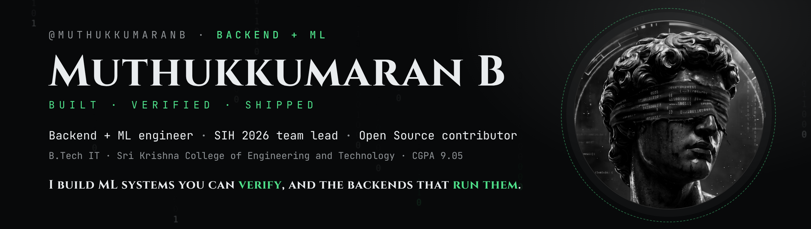

**[Portfolio](https://muthukkumaranb.is-a.dev)** &nbsp;·&nbsp; [Résumé](https://muthukkumaranb.is-a.dev/Muthukkumaran_B_Resume.pdf) &nbsp;·&nbsp; [LinkedIn](https://www.linkedin.com/in/muthukkumaranb/) &nbsp;·&nbsp; [Email](mailto:mailtomuthukkumaranb@gmail.com)

## About

Second-year B.Tech Information Technology student at Sri Krishna College of Engineering and Technology, Coimbatore (CGPA 9.05). I work on backend and machine learning systems, and I care about proving they work: clear baselines, held-out evaluation and results that reproduce from a single command.

- Merged contribution to **deepset Haystack**; open pull request to **LlamaIndex**
- Team lead for **Smart India Hackathon 2026** (team of 6, two problem statements)
- **5x hackathon finalist**
- Open to backend and ML engineering internships: remote part-time now, full-time for Summer 2027

## Open Source

| Project | Contribution | Status |
|---|---|---|
| **deepset Haystack** [haystack-core-integrations](https://github.com/deepset-ai/haystack-core-integrations) | The Lara translator silently ignored `reasoning=False` because of an `x or default` check. Replaced it with an explicit `None` check and added a mocked regression test. [Issue #4168](https://github.com/deepset-ai/haystack-core-integrations/issues/4168) · [PR #4169](https://github.com/deepset-ai/haystack-core-integrations/pull/4169) · [Write-up](https://muthukkumaranb.is-a.dev/notes-x-or-default.html) | Merged |
| **LlamaIndex** [llama_index](https://github.com/run-llama/llama_index) | `SimpleDirectoryReader` crashed when reading through an fsspec `DirFileSystem`. Passed string paths to `fs.open()` and added three regression tests. [Issue #23663](https://github.com/run-llama/llama_index/issues/23663) · [PR #23664](https://github.com/run-llama/llama_index/pull/23664) | In review |

## Selected Projects

All are team projects; each entry states the team size and my contribution.

### [SHIKRA](https://github.com/muthukkumaranb/shikra) — Predicting engine removals for a 54-aircraft fleet
Smart India Hackathon 2026 · SIH26249 (Ministry of Defence) · Team of 6 · Team lead

- **Model:** LightGBM quantile regression with conformal calibration. 11.64 RMSE on NASA C-MAPSS FD001 against an 18.45 published CNN baseline; 81% coverage of 80% prediction intervals on held-out engines.
- **System:** Fleet simulation reduced unscheduled removals from 72.7 to 0 per year; maintenance scheduling with OR-Tools CP-SAT; HMAC-protected audit log.
- **My contribution:** Remaining-useful-life model, data ingestion and audit logging.
- **Stack:** Python, LightGBM, OR-Tools, Streamlit · [Case study](https://muthukkumaranb.is-a.dev/shikra.html)

### [ShadowCat](https://github.com/muthukkumaranb/ShadowCat) — Early attack warning with a tamper-evident log
Smart India Hackathon 2026 · SIH26153 (NTRO) · Team of 6 · Team lead

- **Model:** 0.907 five-minute onset F1 under 37-fold leave-one-episode-out validation; 0.990 detection F1.
- **System:** Ed25519-signed SHA-256 hash chain with a Merkle root, giving an O(log n) inclusion proof for any forecast and offline tamper detection.
- **My contribution:** Data ingestion and the cryptographic audit chain.
- **Stack:** Python, PyTorch, scikit-learn, Ed25519 · [Case study](https://muthukkumaranb.is-a.dev/shadowcat.html)

### [SENTINEL](https://github.com/muthukkumaranb/vitcsiorigins) — Insider threat detection
CSI Origins 2026, VIT Chennai · Finalist · Team of 4

- Detects valid users performing valid actions in invalid patterns by fusing behaviour (45%), sequence (30%) and Random Forest (25%) scores, weighted by operational context.
- **My contribution:** Most of the React and TypeScript investigation console, the Flask API and event processing, the ML dataset builder and model registry, and the API and architecture documentation.
- **Stack:** Python, Flask, scikit-learn, React, TypeScript

### [Mini ERP](https://github.com/muthukkumaranb/minierp) — 14 business modules in one Django codebase
Odoo x KAHE Hackathon · Finalist · Team of 2

- **My contribution:** Inventory, purchasing and procurement with Celery background tasks, an audit log built on Django signals, and the local-LLM (Ollama) voice assistant API.
- **Stack:** Django, HTMX, Alpine.js, Celery, SQLite, Ollama · [Case study](https://muthukkumaranb.is-a.dev/minierp.html)

<b>Other projects</b>

 

| Project | Description | Team |
|---|---|---|
| [HoloTwin](https://github.com/muthukkumaranb/HoloTwin-AeroThon) | Physics-informed digital twin of a turbojet (Aerothon 2026, HAL x IIT Indore). Built the PINN surrogate in PyTorch with physical constraints in the loss, exported to ONNX and benchmarked against a Random Forest. | 2 |
| [ASHA Health Voice Agent](https://github.com/muthukkumaranb/murf-voice-ai) | Multilingual voice assistant for community health workers (Murf AI "10 Days of Voice Agents for Bharat") with consent-based memory, health centre lookup and outbound calls over LiveKit SIP. | — |
| [Air Canva](https://github.com/muthukkumaranb/aircanva) | Gesture-controlled drawing: MediaPipe hand tracking drives a canvas for drawing, erasing and colour selection. | Solo |

## Experience

**Android Development Intern** · Pensive · Remote · *Nov 2026 – Present*
- Building native Android features with Kotlin, Jetpack Compose and Coroutines alongside the iOS and backend teams.

**Team Lead, Smart India Hackathon 2026** · Team of 6 · *Aug 2026 – Oct 2026*
- Led one team through two problem statements in parallel (SHIKRA and ShadowCat), dividing work into data, ML, backend and front-end tracks and reviewing every merge.
- Both projects were shortlisted at the college level and submitted for the national level.

**Student Hackathon Coordinator** · B.Tech IT, SKCET · *Present*
- Coordinate hackathon participation for the department, including the [Tech-Escape](https://www.hackerrank.com/contests/tech-escape/challenges) coding contest.

**Technical Trainer Intern** · CSC Computer Education, Erode · *Apr 2026 – May 2026*
- Taught Python, C and C++ to 50+ students; received a certificate of excellence for communication and technical delivery.

## Hackathons

**Finalist:** Odoo x KAHE (Karpagam) · Samhita (MIT Chennai) · Hydro Hackathon (IIT Madras) · Sparkathon (CIT) · CSI Origins (VIT Chennai)

**Participant:** Smart India Hackathon 2026 · Aerothon 2026 (HAL x IIT Indore) · Murf AI 10 Days of Voice Agents · UIDAI Data Hackathon · Road Safety Hackathon (IIT Madras) · Bharatiya Antariksh Hackathon (ISRO) · Samsung Solve for Tomorrow · Tally CodeBrewers · Snapdragon Multiverse · Flipkart GRiD 8.0

## Technical Skills

| Area | Tools |
|---|---|
| **Backend** | Python, Django, Flask, REST APIs, Celery, SQLite, HTMX, Java, C++ |
| **Mobile** | Kotlin, Jetpack Compose, Coroutines |
| **Machine Learning** | LightGBM, PyTorch, scikit-learn, conformal prediction, pandas, OpenCV, MediaPipe, Ollama |
| **Systems** | SHA-256, HMAC and Ed25519 audit logs, Merkle trees, OR-Tools CP-SAT |
| **Engineering Practice** | pytest, Ruff, uv, Hatch, Git, reproducible pipelines, open-source code review |

## Education

**B.Tech, Information Technology** · Sri Krishna College of Engineering and Technology, Coimbatore · *2025 – 2029* · CGPA 9.05 / 10

---

Open to backend and ML engineering internships · <a href="mailto:mailtomuthukkumaranb@gmail.com">mailtomuthukkumaranb@gmail.com</a>

